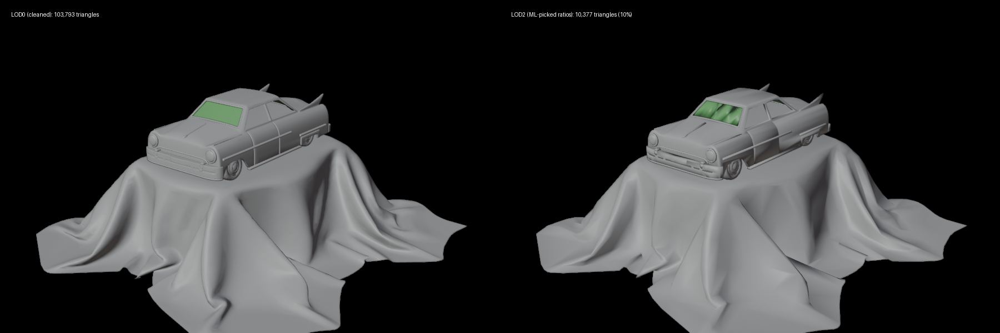

# 3D Asset Automation Pipeline: Blender Cleanup, ML-Driven LODs, Render-Verified glTF

[](https://github.com/adityaaviero47/3d-asset-pipeline/actions/workflows/tests.yml)

Raw 3D models rarely drop straight into a game engine or an XR headset. They
come with duplicate vertices, degenerate faces, rotations and negative scales
baked into parent nodes, 2K textures everywhere and far too many triangles for
real-time use. Artists fix this by hand, mesh by mesh, then guess a
decimation ratio for each level of detail (LOD) and check each guess by eye.

This pipeline does all of that headlessly with Blender's Python API (`bpy`).
A machine-learning model replaces the ratio guessing, and a render-based check
replaces the eyeballing: it compares every LOD with the original on screen and
feeds failures back into the pipeline until they pass.



*ToyCar (Khronos sample asset): cleaned LOD0 at 103,793 triangles vs LOD2 at
10,377 (10%). Some shading drift is visible on the door panel and glass at
full size; at the size LOD2 is shown on screen it passes the visual check
(SSIM 0.91 on the worst of 6 views).*

## What it does

```
raw .glb ─► audit ─► cleanup ─► ML picks LOD ratios ─► verify surface error ─► cap textures
        ─► export LOD0/1/2 .glb ─► Khronos glTF Validator ─► render check ─► (fail? raise ratio, repeat)
```

1. **Audit** every mesh: duplicate vertices, loose geometry, zero-area faces,
   non-manifold edges, unapplied or inherited transforms, negative scale,
   missing UVs or materials.
2. **Cleanup** without changing the visible surface: unparent with transforms
   kept, apply rotation and scale, merge duplicates, dissolve degenerate faces,
   delete loose geometry, recalculate normals, purge unused data.
3. **Pick decimation ratios with ML.** A gradient-boosting model reads 12
   shape features per mesh (triangle count and density, sharp-edge fraction,
   dihedral angles, boundary edges, planarity, aspect ratios…) and predicts the
   smallest ratio that keeps the surface error within budget.
4. **Verify** each LOD once: two-sided point-to-surface distance (95th
   percentile, as a fraction of the bounding-box diagonal). Over budget →
   step up one ratio and re-check.
5. **Cap textures** per LOD (LOD1 ≤ 1024 px, LOD2 ≤ 512 px). Textures, not
   triangles, dominate file size and GPU memory on XR headsets.
6. **Export** `<asset>_LOD0/1/2.glb` (+Y up, metres, modifiers applied) and
   **validate** every file against the glTF 2.0 spec with the official Khronos
   glTF Validator.
7. **Render check.** The surface metric cannot see shading or UV drift, so
   every LOD is rendered from 6 views (Blender Workbench, headless) and scored
   against LOD0 on silhouette overlap (IoU ≥ 0.97) and SSIM of the textured
   render (≥ 0.90). Each LOD is judged at the largest screen size it is
   actually shown at: its LODGroup switch point (LOD1 at 50% of screen
   height, LOD2 at 20%).
8. **Close the loop.** For each LOD that fails, raise that asset's ratios one
   grid step, re-export and re-check, up to 4 rounds. What still fails is
   flagged for an artist.

Budgets: LOD1 surface error ≤ 0.05% of the bounding-box diagonal, LOD2 ≤ 0.2%.

## Data

36 real production-style assets from the
[Khronos glTF Sample Assets](https://github.com/KhronosGroup/glTF-Sample-Assets)
(cars, a truck, props, furniture, a city block): **392 meshes, 2.75M
triangles, 259 MB**. The ML dataset is the 196 meshes with 500+ triangles,
each swept across 11 decimation ratios with the error measured at every step.

## Results

### Cleanup (all 36 assets)

| Defect | Before | After |
|---|---:|---:|
| Duplicate vertices | 643,777 | 30 |
| Unapplied / inherited transforms | 304 | 0 |
| Negative scale | 13 | 0 |
| Zero-area faces | 843 | 242 |

### ML vs baselines (LOD1 budget, tested on unseen assets)

5-fold cross-validation grouped by asset, so every number below comes from
assets the model never saw in training.

| Policy | Meshes within budget | Triangles kept | Decimate + measure runs per mesh |
|---|---:|---:|---:|
| Fixed 50% ratio (typical batch script) | 67.3% | 50.0% | 0 |
| Fixed 20% ratio | 34.2% | 20.0% | 0 |
| Binary search over ratios (exact) | 100% | 19.8% | 3.75 |
| **ML predict + verify** | **100%** | **24.0%** | **1.39** |

- ML needs **63% fewer** decimate-and-measure runs than binary search while
  keeping every mesh within budget (76% of triangles cut vs 80% for search).
- The ML guess passes on the **first try for 77%** of meshes.
- A fixed 50% ratio breaks the error budget on **one mesh in three**.
- At the looser LOD2 budget: ML keeps 11.4% of triangles in 1.36 runs per
  mesh vs 8.8% in 3.81 for search.

### Render check and closed loop (72 LODs: LOD1 + LOD2 of 36 assets)

| | Pass on-screen check | Notes |
|---|---:|---|
| After geometry metric only | 56 / 72 | 16 LODs looked wrong despite a small surface error |
| **After closed loop** | **69 / 72** | 13 of the 16 fixed automatically |
| Flagged for an artist | 3 | LOD2 of Lantern, WaterBottle, BarramundiFish |

Mean silhouette IoU after the loop: 0.999 (LOD1), 0.997 (LOD2).
Mean SSIM at switch size: 0.971 (LOD1), 0.955 (LOD2).

Diagnosis: capping textures alone moves SSIM by at most 0.001 on the worst
cases; the drift comes from decimation changing normals and UVs, which is
exactly what a geometric metric cannot see.

### Production output

| | LOD0 | LOD1 | LOD2 |
|---|---:|---:|---:|
| Triangles | 2.75M | 26.0% | 13.5% |
| File size | 259 MB | 35.0% (91 MB) | 14.2% (37 MB) |

- 108 `.glb` files, **0 errors** from the Khronos glTF Validator.
- 11.2 s per asset on a 2-core CPU (cleanup, LODs, textures, export, validation).

Per-asset numbers: [`results/`](results/).

## Unity

[`unity/`](unity/) has a C# Editor tool, `LodSetImporter.cs`, that imports the
LODs through glTFast, builds a `LODGroup` prefab per asset at the same switch
points the render check uses, and writes a report of triangles, missing
materials and scale per LOD. `compare_with_pipeline.py` cross-checks that
report against the pipeline's. Steps are in [`unity/README.md`](unity/README.md).

## Limitations

- 3 LODs still fail the render check after 4 rounds and need an artist.
- For BarramundiFish the loop raised LOD2 above LOD1's triangle count; a
  cap tying LOD2 to LOD1 is not in yet.
- 242 of 843 zero-area faces survive cleanup: Blender's degenerate-dissolve
  does not remove all of them. Not investigated yet.
- Cleanup flattens the node hierarchy (meshes are unparented to bake their
  transforms). Animated and skinned assets need a different path.
- The render check uses Workbench lighting, not the target engine's
  physically based shading.

## Run it

```bash
python -m venv venv && ./venv/bin/pip install -r requirements.txt   # bpy = Blender 5.3 as a module
(cd tools && npm install)                                            # Khronos glTF Validator

# assets: sparse-clone Models/*/glTF-Binary from KhronosGroup/glTF-Sample-Assets into data/
cd pipeline
python build_dataset.py ../data ../out                 # 1. audit, cleanup, ratio sweep  (~20 min, 2 cores)
python train_eval.py ../out/dataset.json               # 2. ML vs baselines, grouped CV
python run_pipeline.py ../data ../out/dataset.json ../out/lods ../tools/validate.mjs   # 3. LODs + validation
python visual_check.py ../out/lods ../out/visual.json  # 4. render check
python refine.py ../data ../out/dataset.json ../out/lods ../tools/validate.mjs ../out/visual.json  # 5. closed loop
cd .. && python -m pytest -q tests                     # metric tests
```

## Layout

```
pipeline/blender_ops.py     import, audit, cleanup, decimate, texture caps, export (bpy)
pipeline/geometry.py        surface-error metric and 12 mesh shape features
pipeline/build_dataset.py   stage 1: audit + cleanup + ratio sweep per mesh
pipeline/train_eval.py      stage 2: ML model vs fixed-ratio and search baselines
pipeline/run_pipeline.py    stage 3: production LODs + texture caps + validation
pipeline/visual_check.py    stage 4: 6-view render check (silhouette IoU + SSIM)
pipeline/refine.py          stage 5: re-run failing LODs until they pass
pipeline/render_preview.py  headless render of any .glb
unity/                      C# LODGroup importer + cross-check against the pipeline
tools/validate.mjs          Khronos glTF Validator wrapper
tests/                      metric tests (self-error is zero, scale-free, monotonic), run by GitHub Actions on every push
results/                    every number above, per asset
```
